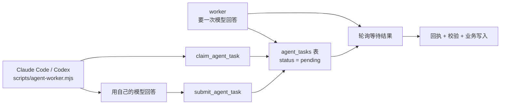

# 用 IDE 当 AI 引擎（不需要 API Key）

默认情况下，每一步 AI 都由 `LLM_BASE_URL` / `LLM_API_KEY` 指向的服务完成。开启 `AGENT_ENGINE=mcp` 后，这些调用改由支持 MCP 的 IDE（Claude Code、Codex 等）用自己的模型回答：引擎把提示词写进数据库里的任务队列等着，IDE 来领取、回答、交回结果。

api 和 worker 都不需要模型密钥。除提示词的运输方式以外，其它行为不变：同样的回执、预算、熔断、提示词版本与输出校验，失败分类也一样（IDE 迟迟不来按“服务暂时不可用”处理，下次重试再排新任务）。

## 它是怎么运转的



1. worker 要一次模型回答时，把 system 与 user 提示词写入 `agent_tasks`，然后轮询等结果。
2. IDE 侧通过 MCP 调 `claim_agent_task` 领一条，租约默认 300 秒。
3. IDE 用自己的模型生成答案，调 `submit_agent_task` 交回。
4. worker 取到答案（同一条 SQL 里把任务删掉），走原有的解析、schema 校验、回执与业务写入。

任务行只在被处理期间存在：答案被取走即删除，放弃也立即删除，所以提示词不会在库里堆积。

## 开启

`.env` 里加三段：

```bash
# 让 default 模型改由 MCP 客户端回答
AGENT_ENGINE=mcp
# 领取任务的令牌，至少 16 位，和 INGEST_TOKEN 分开
AGENT_ENGINE_TOKEN=<openssl rand -hex 32 的结果>
# 可选：租约与等待上限（秒）
AGENT_TASK_LEASE_SECONDS=300
AGENT_TASK_TIMEOUT_SECONDS=300
```

重启 api 与 worker。此时 `LLM_BASE_URL` / `LLM_API_KEY` 可以留空；`MODEL_CALLS_ENABLED=true` 仍然要开，它是所有模型调用的总开关。

单独用环境变量把某一步指向具名预设（比如 `SCORE_MODEL=glm-5.3-flash-selection`）时，那一步仍然直接调用对应服务，需要它自己的 key。要全部走 IDE，把这些变量都留空。

## 让 IDE 开始供能

服务端只提供队列，真正答题的是 IDE 侧的一个循环。仓库自带 `scripts/agent-worker.mjs`：

```bash
# 只看看领到什么提示词，不真的回答
node scripts/agent-worker.mjs --url http://127.0.0.1:3001/api/mcp-engine --token <token>

# 用本机已登录的 Claude Code 回答
node scripts/agent-worker.mjs --token <token> --exec "claude -p"

# 用 Codex 回答（命令以 - 结尾表示从 stdin 读提示词）
node scripts/agent-worker.mjs --token <token> --exec "codex exec --skip-git-repo-check -"
```

`--exec` 指定的命令收到一条提示词、在 stdout 打印答案即可。命令以 `-` 结尾时提示词从 stdin 传入，否则作为最后一个参数传入。常见选项：`--name claude-code`（队列里显示的名字）、`--interval 2000`、`--once`、`--verbose`。

也可以把它挂成一个后台服务，或直接让你用的 MCP 客户端连上来：把下面这段加进客户端配置即可，agent 侧只有四个工具，与站点公开的只读 MCP 完全分开。

```json
{
  "mcpServers": {
    "aihot-engine": {
      "type": "http",
      "url": "http://127.0.0.1:3001/api/mcp-engine",
      "headers": { "Authorization": "Bearer <AGENT_ENGINE_TOKEN>" }
    }
  }
}
```

## 工具

| 工具 | 作用 |
|---|---|
| `<前缀>_claim_agent_task` | 领取下一条待答提示词；队列空时返回 `task: null` |
| `<前缀>_submit_agent_task` | 交回答案；租约过期会被拒绝，需要重新领取 |
| `<前缀>_release_agent_task` | 不答、放回队列 |
| `<前缀>_agent_queue_status` | 看待领取与进行中的数量，确认队列通不通 |

`<前缀>` 是 `site/site.ts` 里 `mcpPrefix` 的值，和公开 MCP 工具一致。

## 要注意的地方

- 吞吐取决于你是否开着 IDE：一个 IDE 一次答一条，比直接调 API 慢一到两个数量级。适合自建站、低频出刊，不适合按天大量出稿的站点。
- 答案质量由 IDE 的模型决定。引擎仍按原有 schema 校验，不合格的回答会记为 `unusable output` 并重试，不会污染业务数据。
- 图片不会进任务队列：需要看图的步骤（`LLM_VISION=true` 时的标题摘要）在 agent 模式下拿不到图，只按文字处理。
- 任务表里是完整提示词，只留在数据库里；答案被取走即删除，进程退出也不会留下积压。
- `AGENT_TASK_TIMEOUT_SECONDS` 上限是 540 秒：回执的 pending 窗口是 10 分钟，超过就会被判为结果未知，答案再也用不上。
